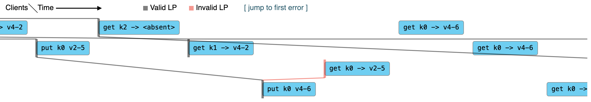

# fuss

Test a real distributed system against a documented guarantee. Define the cluster, fault, and check in one scenario file, then replay the run.

## Zero-root, CI-native fault injection

fuss tests unmodified distributed system binaries under reproducible network and process faults on a laptop or in standard CI—with no root, no iptables, no Docker-in-Docker, and no JVM/Clojure setup.

It does not replace a full-stack deterministic hypervisor like [Antithesis](https://antithesis.com/) (target goroutines, clocks, and disk I/O remain non-deterministic), nor does it replace multi-host [Jepsen](https://github.com/jepsen-io/jepsen) clusters. Instead, fuss gives you a single static Go binary for seeded, reproducible black-box fault injection with built-in [Porcupine](https://github.com/anishathalye/porcupine) linearizability checking and failure bundles.

### What fuss provides

- **Zero-root L4 chaos proxy** (`proxy/`): Routes peer-to-peer and client-to-node (`client_via_proxy: true`) TCP traffic in userspace using PID-attributed sockets (`per_node_owned`). Supports reset (close + refuse), blackhole (discard bytes so peers hit read deadlines, closing dirty sockets on Heal()), and degraded (seeded one-way latency, jitter, and chunk drops) with independent direction (`both`, `inbound`, `outbound`) and byte flow (`both`, `a_to_b`, `b_to_a`).
- **Composable YAML nemesis:** Runs a seeded schedule (warmup → weighted `isolate_node`, `isolate_client`, `partition_halves`, `kill_node` + restart, `pause_node`, `heal_all` → mandatory `heal_all` + `quiet_period` + ready re-probe) while concurrent `http_kv` or `exec_op` workers hammer the cluster.
- **Unified histories and [Porcupine](https://github.com/anishathalye/porcupine) traces:** Records client operations (`ok`, `fail`, and open-ended `info` timeouts) in `history.jsonl` and Jepsen-compatible `history.edn` on the same monotonic `scheduleStart` clock as `nemesis_events.json`. Any `NONLINEARIZABLE` or checker-timeout run automatically emits `porcupine.html`.
- **Property telemetry (ALWAYS / EVENTUALLY / SOMETIMES):** Enforces safety (`porcupine`, `set`) and post-recovery liveness (`eventually_available`), and fails `-n > 1` runs (`UNMET_SOMETIMES`) if targeted fault windows like `fault_during_inflight` or `fault_action_fired` hit 0 times.
- **CI-ready failure bundles:** `-save-failed-bundle <dir>` captures `history.jsonl`, `history.edn`, `nemesis_events.json`, `porcupine.html`, `target.log`, `scenario.yaml`, and `bundle.json` under `<dir>/seed-<seed>/` for any non-PASS trial, ready for `-replay-bundle`. `-save-bundle` still records one seed, so `-n` must be 1.

### Verified runs on real systems

| Target | Scenario | Faults exercised | Fuss verdict | What it showed |
| --- | --- | --- | --- | --- |
| [etcd v3.7.4](https://github.com/etcd-io/etcd) | `etcd-serializable.yaml` | blackhole and reset (`client_via_proxy`) | `NONLINEARIZABLE` (`porcupine.html`) | Documented stale reads on a partitioned minority under a serializable range |
| [etcd v3.7.4](https://github.com/etcd-io/etcd) | `etcd-linearizable.yaml` | blackhole and reset (`client_via_proxy`) | `PASS` | Linearizable reads block or time out (`info`) rather than returning stale data |
| [otoolep/hraftd](https://github.com/otoolep/hraftd) | `hraftd.yaml` (`-n 5`) | blackhole, `partition_halves`, `kill_node` | 3× `NONLINEARIZABLE`, 2× `UNKNOWN` (`nodes_not_ready`) | Uncoordinated local GET stale reads, and a follower `-join` restart that is not ready when node 0 is down |
| [rqlite v10.7.4](https://github.com/rqlite/rqlite) | `rqlite-http.yaml` | `kill_node` (`fault_during_inflight` hit) | `PASS` | The seed recovered and the HTTP history stayed linearizable |

These rows are the runs already recorded on this machine. The etcd serializable `NONLINEARIZABLE` is the documented stale range, not a claim that etcd broke linearizable reads. The hraftd counts are one `-n 5` from seed 1, not a 10-replay of one state. The rqlite row is seed 1: `kill_node` fired, and `isolate_node` was not drawn.

### Quick example

```bash
# Run 5 seeded trials and save bundles only for failing seeds
./fuss -target-config examples/hraftd/hraftd.yaml -n 5 -seed 1 -save-failed-bundle ./runs/hraftd

# Inspect any failing seed's Porcupine timeline
open ./runs/hraftd/seed-1/porcupine.html

# Replay a saved bundle
./fuss -replay-bundle ./runs/hraftd/seed-1
```

Window of the seed-1 hraftd trace (`notes/runs/hraftd-seed1/porcupine.html`). Fuss verdict `NONLINEARIZABLE`. The red mark is Porcupine's first illegal linearization point.



## Three nodes

repkv is a small replicated key-value store in this repository. Correct mode acknowledges a write only after a follower has it. Bug mode acknowledges first and replicates later.

```bash
git clone https://github.com/kriyanshii/fuss.git
cd fuss
go build -o fuss .
go build -o examples/repkv/repkv ./examples/repkv

./fuss -target-config=examples/repkv/repkv.yaml -seed=1 -n=10 -json
./fuss -target-config=examples/repkv/repkv-bug.yaml -seed=1 -n=10 -json
```

Correct mode prints `"verdict":"PASS"`. The check read the value from the surviving leader after Fuss applied the partition. Bug mode prints `"verdict":"LOST WRITE"`. That read succeeded, and the value was missing.

On this machine, seeds 1 to 10: correct mode 10 PASS, bug mode 10 LOST WRITE. Each trial's `-json` line carries `evidence.isolate` for the cut and `evidence.check.out` for the read. A correct-mode read looks like:

```
PASS read_from=node_1 leader=self after_cut=yes
```

A bug-mode read looks like:

```
LOST WRITE read_from=node_1 leader=self after_cut=yes value_missing=yes
```

`read_from` is `node_1` or `node_2`, the leader that remains after `node_0` is cut. A failed read is `UNKNOWN` with a reason (`examples/repkv/repkv-read-error.yaml`, 10 UNKNOWN on this machine, `reason=read_error`).

Replay the saved bug-mode failure from a clean checkout:

```bash
./examples/repkv/replay.sh
```

The command rebuilds Fuss and repkv, runs the saved scenario and seed, and prints the acknowledgement, the applied partition, and the read:

```
ack: key=1-0
cut: target=node_0 direction=both links_cut=4 trigger_fired=true
read: key=1-0 read_from=node_1 status=ok found=false
verdict: LOST WRITE
```

That block is a replay on this machine. Exit 0 means the new run showed those three facts, the read named the same key as the acknowledgement, and the verdict matched. repkv pins `node_0`, so the cut target must be the same node. An etcd scenario that writes the leader into `node_file` prints `saved=` and `replay=` targets. A different index still passes when that index was the leader before the cut.

## The same file, on rqlite and etcd

rqlite and etcd use the same shape: three processes, one acknowledged write, a symmetric partition, then a read from a new leader. rqlite cuts `node_0` after that node has reported itself leader. etcd writes the elected leader's name to `${dir}/leader_node` and Fuss cuts that member. Fuss writes `${dir}/isolate_applied.json` when the cut is applied. The scenario reads only after that file names the intended member with `trigger_fired` true and `links_cut` greater than 0. A timeout, a failed query, or a malformed body is `UNKNOWN` with a reason. `LOST WRITE` requires a successful read that shows the value is missing. If etcd's leader changes between the acknowledgement and the cut, the verdict is `UNKNOWN` and there is no post-cut read.

```bash
./fuss -target-config=examples/rqlite/rqlite.yaml -seed=1 -n=1 -json
./fuss -target-config=examples/etcd/etcd.yaml -seed=1 -n=1 -json
```

rqlite v10.7.4, seed 1, on this machine: `PASS read_from=node_2 raft_state=Leader after_cut=yes`. The write body was checked before the acknowledgement. Replaying `examples/rqlite/bundles/pass` printed `ack: key=1-0`, a 4-link cut of `node_0`, and `read: key=1-0 read_from=node_1 status=ok found=true`.

The checked example is [`examples/rqlite`](examples/rqlite). The live result and the control both read `${home}/result.txt`. A planted LOST WRITE line must be judged LOST WRITE, and a missing result file is UNKNOWN. Raft listens on `${addr_raft}` through the proxy. HTTP listens on `${addr_http}` and is not proxied.

etcd v3.7.4, seeds 1 to 4 on this machine, all PASS. The cut target was `node_0`, `node_0`, `node_1`, and `node_2`. Each read came from a different member and included that leader's id (`leader_id`) and the cut target (`cut_target`). `links_cut` was 4 and `trigger_fired` was true. A saved seed-1 run is `examples/etcd/bundles/pass`.

Save a run and replay it with the same bundle format:

```bash
./fuss -target-config=examples/rqlite/rqlite.yaml -seed=1 -n=1 -save-bundle=/tmp/rqlite-bundle
./examples/rqlite/replay.sh /tmp/rqlite-bundle
```

The bundle stores the scenario, the Fuss revision, the target version and checksum, the seed, the acknowledgement, the cut, and the read.

## What Fuss has shown so far

- repkv, seeds 1 to 10 on this machine: correct mode 10 PASS, bug mode 10 LOST WRITE, read-error mode 10 UNKNOWN. The PASS and LOST WRITE trials had an applied partition and a read from the surviving leader.
- rqlite v10.7.4, seed 1: PASS after a strong read from `node_2`, with the cut applied (`links_cut=4`).
- etcd v3.7.4, seeds 1 to 4: PASS after cutting the elected leader and reading the value from a survivor.

Limits, stated plainly:
- The rqlite fault is a symmetric isolate of `node_0` after that node has reported itself leader. rqlite still advertises one Raft address per node; `per_node_owned` tags the source process, so node 0's outbound heartbeats are refused and nodes 1 and 2 keep talking. There is no pause.
- The etcd fault is a symmetric isolate of whichever member acknowledged the write. Fuss reads that name from `${dir}/leader_node` when the trigger fires. The member id in the result is the id etcd assigned at startup.
- A PASS is the documented guarantee for this one scenario and this one fault.
- No new bugs found yet.

Fuss is also a skill for Claude Code, Cursor, Codex, and Gemini CLI. The skill runs this same loop. People pick the promise and approve the check. Verdicts come from Fuss. See [Why the AI never judges](#why-the-ai-never-judges).

## Five minutes

```bash
git clone https://github.com/kriyanshii/fuss.git
cd fuss
go build -o fuss .
go build -o toykv ./examples/toykv
```

Default toykv returns 200 before the write is on disk. `-adapter=toykv` loads
`examples/toykv/toykv.yaml`.

```bash
./fuss -adapter=toykv -seed=1 -n=10 -json
```

Each trial prints `"verdict":"LOST WRITE"` (exit 1). The `lost-write` control
must show `"ok":true` first.

Same binary with fsync on, so a 200 means the write is on disk
(`examples/toykv/toykv-fsync.yaml` passes `-fsync`):

```bash
./fuss -target-config=examples/toykv/toykv-fsync.yaml -seed=1 -n=10 -json
```

Each trial prints `"verdict":"PASS"` (exit 0).

Your binary: copy one YAML and point `-target` at it.

```bash
cp examples/toykv/toykv.yaml my.yaml
# edit args, health, workload, and check
./fuss -target-config=my.yaml -target=/path/to/your-binary -seed=1 -n=10 -json
```

Do not write into the target's data dir. Fuss does not. The demo server is
`examples/toykv/README.md`.

## In CI

Other repos can call this composite action from a workflow. Pin a commit SHA
until you cut a tag; `@v0` in the example is the ref you would use after that.

```yaml
    - uses: kriyanshii/fuss@v0
      with:
        config: path/to/your.yaml
        target: ./your-binary
        seed: "1"
        n: "10"
```

Every trial's `verdict` must match `expected-verdict` (default `PASS`). Set it
to lock in a known failure such as toykv's `LOST WRITE`.

The repository workflow also runs repkv on Linux and macOS: correct mode, bug mode, and a read that is forced to fail. The job checks the verdict, that the partition landed, and that a PASS or LOST WRITE read came from the surviving leader. The failed read must be UNKNOWN.

## Why the AI never judges

An agent running the skill can suggest promises to test, draft code and draft
reports. It never decides whether the target passed or failed. Every verdict
comes from Fuss's own check, printed in its `-json` output:

- **A verdict has to replay.** A seed replays the same fault, and the check
  reads the same evidence the same way each time. A model's answer can change
  between two runs on the same input, so it cannot be replayed or audited.
- **A check is proven before it is trusted.** Each check must first catch a
  known broken state (a control). If a control fails, Fuss runs no seeds and
  exits 3. There is no such test for a model's judgement.
- **Models misread logs with confidence.** A wrong count or an overstated
  claim reads just as convincingly as a right one. The check counts the log
  the same way every time.

People pick which promise to test and approve each check. The model helps
with the work around them; the code decides.

## Running

```bash
# Build
go build -o fuss .

# Test the fake adapter (no external binary needed)
./fuss -adapter=fake -n=5

# Test Dagu (requires Dagu binary)
./fuss -adapter=dagu -dag=one -target=/path/to/dagu -n=10

# Three-node repkv (correct, then the lost-write bug)
./fuss -target-config=examples/repkv/repkv.yaml -n=10 -seed=1 -json
./fuss -target-config=examples/repkv/repkv-bug.yaml -n=10 -seed=1 -json

# Replay the saved repkv failure
./examples/repkv/replay.sh

# Test rqlite (YAML fixture; needs rqlited v10.7.4, see examples/rqlite)
./fuss -target-config=examples/rqlite/rqlite.yaml -n=1 -seed=1 -json

# Test etcd (YAML fixture; needs etcd v3.7.4, see examples/etcd)
./fuss -target-config=examples/etcd/etcd.yaml -n=1 -seed=1 -json

# Run tests
go test ./...                          # Unit tests (no external binaries needed)
go test -run TestDaguIntegration       # Dagu integration tests (needs dagu)

# Old Dagu mode (backward compatible, no -adapter flag)
./fuss -target=/path/to/dagu -dag=one -n=2
```

Add `-json` for one JSON line per trial, control and summary (seed, mode,
where the fault landed, verdict, evidence, trial dir) instead of the human
output. Without it, the output is unchanged.

To run the loop through an agent, see `skills/fuss/SKILL.md` and
`skills/fuss/INSTALL.md` (Claude Code: `/fuss <target and what to test>`).

Without `-target`, Fuss uses the default binary name from `PATH` (e.g., `dagu`
for the Dagu adapter, `rqlited` for the YAML rqlite example), and stops with
an error if not found. Either way it prints the binary it resolved to stderr
at startup (`fuss: <target> = … (from …)`), so a run never silently uses the
wrong one.

## Testing your own program

Copy `examples/toykv/toykv.yaml`, edit it with `skills/fuss/CONFIG.md`, and run:

```bash
./fuss -target-config yours.yaml -json
```

Or type `/fuss` in Claude Code and let it draft the config.

`kill.signal` is accepted in YAML and not read yet. Kills stay SIGKILL
(see `skills/fuss/CONFIG.md`). The Dagu Go adapter (`dagu_adapter.go`) remains
as an older example. The old rqlite Go adapter (`rqlite_adapter.go`,
`-adapter=rqlite`) does nothing useful now that `examples/rqlite/rqlite.yaml`
exists; use the YAML fixture.

`notes/` holds predictions written down before each run, kept next to what the
run actually showed, and the issue draft as it was before filing (the filed
issue is the current version).

## Limits

### Reading Dagu's files

Spec 031 puts "the persistence format and run-store file layout" outside the
spec (`specs/031-human-task.md:443-444`). Fuss reads those files anyway in
these places. It only reads them; it never writes into `DAGU_HOME`.

| What | Read for | File |
|---|---|---|
| `status.jsonl` (run status) | timing the kill in `-dag=human -kill-at=queued`; labels in `-kill-at=end`, `-kill-at=stratified` and `-measure` | `measure.go` |
| `data/queue/*/item_*_<run-id>.json` | the human-task labels, **and** the STRANDED verdict ("no queue item") | `human.go` |

For `-kill-at=queued`, the status file only decides *when* to kill. Labels and
verdicts never use it. It also costs a read every millisecond while
`complete` runs, so Fuss's polling may shift Dagu's timing.

The STRANDED verdict does rely on the queue directory layout. That layout was
seen by hand, not read from a spec. Before any seed runs, the queue control
checks that an unkilled `complete` leaves exactly one item that Fuss can see.
If Fuss counts zero there, nothing runs.

Every other verdict comes from the outside record (`start after <run-id>`
lines) and `dagu status`.

If Dagu changes either layout, `-kill-at=queued` stops with an error (no
status file for a Waiting run), or the queue control fails. A changed status
encoding could instead mean Queued is never seen; those trials print
`queued-seen=never`.

### Undocumented env vars in the older modes (an exception)

Fuss's rule is to change Dagu's settings only through documented `DAGU_*`
env vars. The older modes break it: `-dag=one`, `-dag=two`, the zombie
control (which runs first by default) and `-measure` set
`DAGU_PROC_HEARTBEAT_INTERVAL=1s` and `DAGU_PROC_STALE_THRESHOLD=5s`
(`daguEnv`, `dagu.go`). The zombie control's staged reader uses a 1h stale
threshold instead (`zombieReader`, `control.go`).

Why: Dagu marks a dead run Failed only after its heartbeat is older than the
stale threshold, 90s by default. Lowering it makes rule 3 testable in seconds.
The settings themselves are documented as config-file keys
(`proc.heartbeat_interval`, `proc.stale_threshold` in Dagu's config schema),
but their env var form appears only in Dagu's code, not its README. This is
left as a documented exception rather than changed, because changing those
modes risks byte-for-byte replay of old `-dag=one` seeds.

The human-task finding does not use them. `-dag=human` runs every Dagu
command with only `DAGU_HOME` and `DAGU_AUTH_MODE=none` added to the inherited
environment, and it exits before the zombie control. The issue's shell
reproducer sets the same two. Both inherit the shell's environment, so a
`DAGU_PROC_*` already exported there would pass through. Check with
`env | grep DAGU_` before a run.
